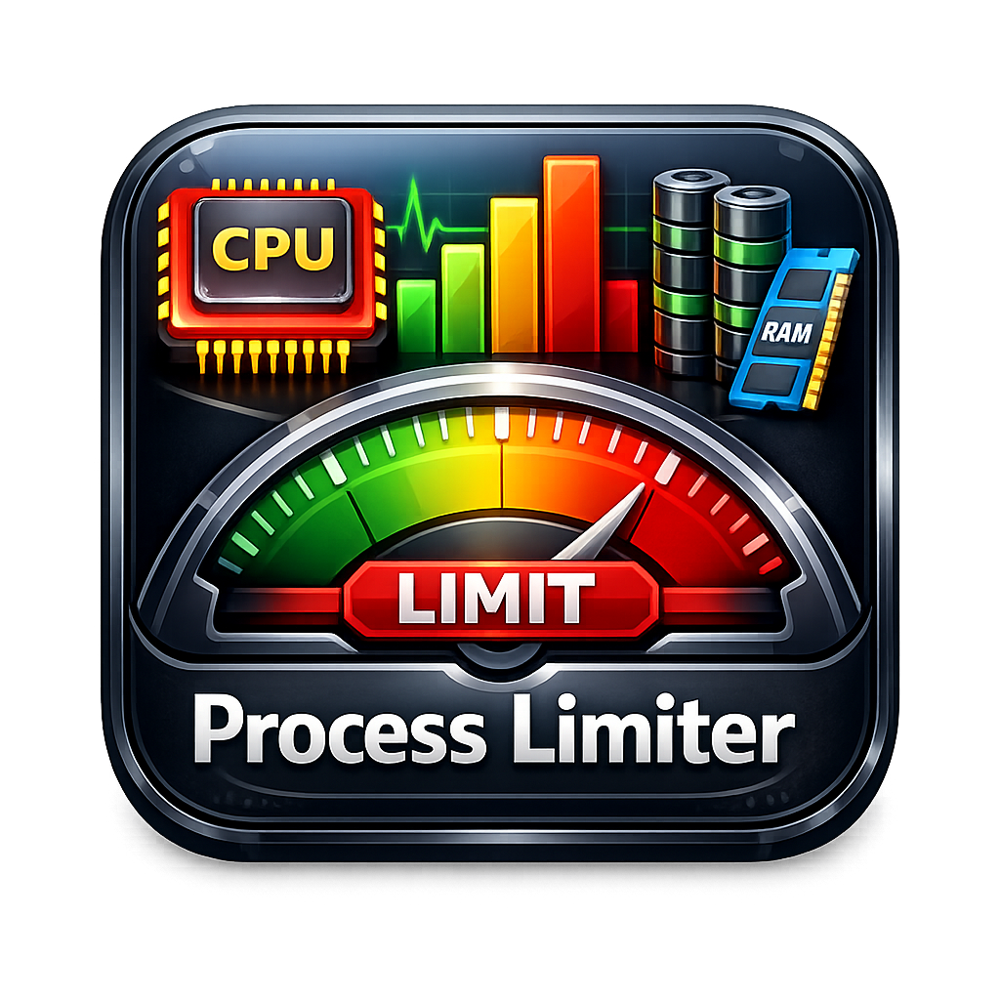

<p align="center">
  
</p>

<h1 align="center">PLimit — Process Limiter</h1>

<p align="center">
  A lightweight Windows utility to manage and fine-tune running process priorities, CPU affinity, I/O priority, process priority boost, thread priority boost, and efficiency mode — all from a clean dark-themed UI.
</p>

---

## Requirements

- Windows 10 / 11 (64-bit)
- [.NET 10.0 Desktop SDK for compilation](https://dotnet.microsoft.com/en-us/download/dotnet/10.0)
- **Run as Administrator** (required to modify process settings)

---

## Getting Started

1. Download the latest release from the [Releases](../../releases) page.
2. Extract and run `PLimit.exe` **as Administrator**.
3. The process list loads automatically on startup.

> **Note:** Administrator privileges are required to change priority, affinity, or efficiency mode for most system processes.

---

## Features

### 🔍 Process List & Search
- Displays all currently running processes with their name and PID.
- Use the **search box** to filter by process name or PID in real time.

### ⚡ CPU Priority
Right-click a process to set its CPU scheduling priority:

| Level | Description |
|---|---|
| **Real Time** | Highest possible — use with caution, can freeze the system |
| **High** | Above most processes; good for foreground apps |
| **Above Normal** | Slightly elevated over standard processes |
| **Normal** | Default Windows priority |
| **Below Normal** | Deprioritised; runs after normal processes |
| **Idle** | Only runs when the CPU is otherwise idle |

### 💾 I/O Priority
Control disk access priority for a process:
- **High** — Prioritised disk access
- **Normal** — Default disk access
- **Low** — Throttled disk access
- **Very Low** — Minimal disk access (background tasks)

### 🧩 CPU Affinity
Restrict a process to specific CPU cores via the right-click context menu. At least one core must remain enabled.

### 🚀 Process Priority Boost
Use **Automation & Rules… → Responsiveness** to enable foreground boosting. PLimit temporarily raises a Normal-priority foreground application to Above Normal, then restores its priority when focus changes or boosting is disabled. Explicit saved priorities, efficiency rules, excluded applications, and non-Normal priorities take precedence.

The right-click **Windows Dynamic Priority Boost** menu controls a separate Windows feature: brief scheduling boosts after waits. It applies to the entire process, including future threads. The former duplicate process/thread boost actions are consolidated; legacy settings remain supported.

### ⚖️ Background CPU Balancing
Enable balancing in **Automation & Rules…** to temporarily lower busy Normal-priority background applications to Below Normal during sustained CPU pressure. Defaults are 80% system CPU, 15% per-process CPU, and 3 seconds of sustained load. A separate recovery threshold and quiet period prevent rapid priority switching. Foreground applications are released immediately.

Foreground boost and balancing start **disabled**. They operate on accessible applications in your session and exclude PLimit, critical Windows processes and selected system components. This is PLimit's own balancing policy, inspired by the behavior described in [Process Lasso's ProBalance documentation](https://bitsum.com/apps/process-lasso/docs/algorithms/probalance/), not an implementation of its proprietary algorithm.

### 🎛️ Sustained-load CPU Limiter
Right-click an application → **Automation rule…**, or open the **Process rules** tab to add, edit or remove a rule, including for applications that are not currently running.

- Choose a CPU threshold, time above it, number of allowed cores to retain, and restriction duration.
- CPU percentages represent total machine capacity, not a single core.
- The limiter uses a subset of each instance's existing affinity and restores that instance's original mask after the duration. It then requires a fresh sustained-load interval.
- This limits available cores; it is not an exact CPU percentage cap. Short bursts are allowed. Affinity automation is unavailable on systems with multiple processor groups.
- Rules match exact process names, case-insensitively, with or without `.exe`. They apply to all accessible matching instances in your session.

This approach follows the principle described in [Process Lasso's CPU Limiter documentation](https://bitsum.com/apps/process-lasso/docs/algorithms/cpu-limiter/). Exclusions for foreground boost and background balancing can be configured in the same rule editor; they do not disable an explicitly configured limiter.

### 📝 Continuous Rules & Activity
**Enforce saved settings** applies saved priority, affinity, dynamic boost, efficiency and I/O settings to existing and newly launched applications, checking them every five seconds. Enforcement runs independently of searching, hovering over the list, or minimizing the window.

The **Activity** tab shows the latest 250 actions and failures for this session. Temporary priority and affinity changes are restored on normal exit; external changes are preserved. Process identity includes creation time, and native handles remain tied to the original instance. Forced termination or a system crash cannot run this restoration.

### 🌿 Efficiency Mode
Toggle Windows **EcoQoS** (Efficiency Mode) on or off for a process. Efficiency Mode reduces CPU and power usage — ideal for background apps.

### 📊 System Monitor
A live bar graph at the bottom of the window shows:
- **Per-core CPU usage** — colour turns red above 90%
- **RAM usage** — displays used/total (GB or MB), colour turns red above 85%

---

## Settings

| Option | Description |
|---|---|
| **Save Settings** | Persists your priority/affinity/boost/efficiency/I/O choices to `Settings/processes.json` |
| **Enforce saved settings** | Applies saved settings at startup, to new instances, and while PLimit remains open (reuses the previous startup preference) |
| **Automation & Rules…** | Saves global boost/balance options and per-process exclusions/limiter rules to `Settings/automation.json` |

Settings are stored next to the executable. Automation rules are saved explicitly through their dialogs, independently of **Save settings**. Invalid files are reported in Activity; the background engine retains the last valid configuration until the files are corrected. Disabling enforcement always stops saved-setting enforcement. The automation engine is part of the application, not a Windows service, so PLimit must remain open.

---

## Building from Source

```bash
# Clone the repository
git clone https://github.com/0x78654C/PLimit.git
cd PLimit

# Build
dotnet build PLimit.sln -c Release

# Run regression tests
dotnet test PLimit.sln -c Release
```

The output is placed in `PLimit\bin\Release\net10.0-windows\`.

---

## Release Notes

See the [Releases](../../releases) page for the latest changes.

---

## License

See [LICENSE.txt](LICENSE.txt) for details.

## Screenshot


